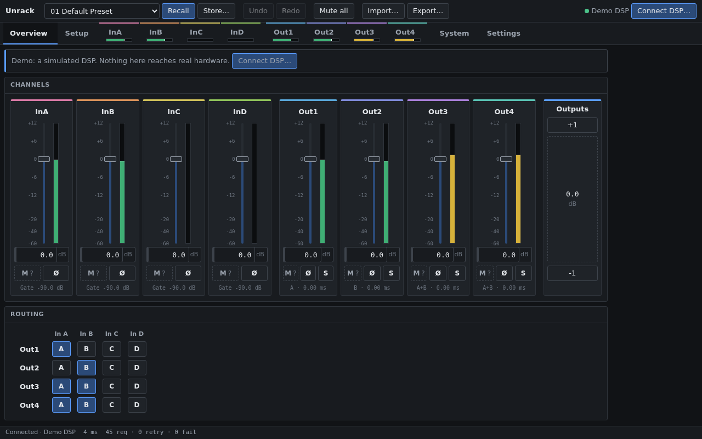

# Unrack

> [!WARNING]
> **Built with heavy use of AI.** Since the fork, most of Unrack's code and docs have been
> written with LLM coding assistants ("vibe-coded"). It is unit-tested and checked against a
> real DSP, but expect bugs. Unrack writes settings to a device that drives amplifiers and
> speakers: a wrong crossover, gain or limiter can damage drivers, amplifiers or hearing. Check
> your settings at low volume first, and **use it at your own risk**. It comes with no warranty
> (see the [license](LICENSE)), and the authors are not liable for any damage or loss.

Open-source control software for rack DSPs whose vendor editors are Windows-only. Runs in
desktop Chrome/Edge over WebHID with nothing to install, on Android phones/tablets over
USB-OTG, and over Wi-Fi from any browser through an ESP32-S3 plugged into the DSP
(see [Wi-Fi bridge](#wi-fi-bridge-esp32-s3)).

> **Only one device is supported today: the t.racks DSP 4x4 Mini Pro.** More DSPs are planned,
> see [Compatibility](#compatibility) and how to help.

**[Open the web app](https://askz.github.io/unrack/)** · plug the DSP in, click *Connect DSP…*.
No DSP plugged in? It opens a demo with a simulated DSP ([try the demo](https://askz.github.io/unrack/?demo)).



## Compatibility

| Device | Status | Notes |
|---|---|---|
| t.racks DSP 4x4 Mini Pro | **Supported** | Desktop (WebHID) verified on firmware `4x4MINIPRO V010 20230106A`. Android builds in CI; the file import/export bridge still needs a test on a phone. |
| t.racks DSP 206, DSP 408 | Not yet | Use the same Windows editor as the 4x4 Mini Pro, so the protocol is likely close. |
| Peavey VSX26e, VSX48e | Not yet | Same editor family as the t.racks units above. |
| Your DSP | Not yet | Help wanted, see below. |

**Help add a device.** Contributions are very welcome, no coding required:

- **Record a USB session** of the official editor talking to your DSP and attach it to an issue.
  [`docs/CAPTURING.md`](docs/CAPTURING.md) walks through it (about 10 minutes, Windows + Wireshark).
- **Send or lend a device.** Having the hardware on the bench is the fastest way to full support,
  because every parameter can be verified by reading it back.
  [Open an issue](https://github.com/askz/unrack/issues/new) to arrange shipping.
- **Write code.** Pull requests for new devices, fixes and tests are welcome.

## Origins

Unrack started as a hard fork of [openDSP-4x4](https://github.com/GlassOnTin/opendsp-4x4) by
Ian Williams ([@GlassOnTin](https://github.com/GlassOnTin)), the first clean-room implementation
of the t.racks DSP 4x4 Mini Pro protocol, with its WebHID web app and Android shell. His protocol
research ([`PROTOCOL.md`](PROTOCOL.md)) and original code are the foundation of the t.racks
support. Since the fork, the transport, state layer and UI have been rebuilt.

## Features

- **All device parameters**: gain, mute, polarity, delay, routing, 7-band PEQ (peak, shelves,
  pass, all-pass), high/low-pass crossovers (Butterworth, Bessel, Linkwitz-Riley), compressor /
  limiter, noise gate, test tone, front-panel lock password.
- **Classic editor layout**: overview of all eight channels as mixer strips plus the routing
  matrix, one tab per channel, System page (device facts, 30 preset slots, preset files, test
  tone, issue log). Works at phone width.
- **Mixer tools**: solo on outputs, *Mute all* (and back to how the mutes were), and a master
  trim that moves all four output gains together, keeping their differences.
- **Setup**: pick a speaker layout (2.0 stereo, 2.1, 2.2, Top / Kick / Sub in stereo or mono,
  bi-amp stereo, 4-way mono) and an environment (neutral, indoor, outdoor, club, speech,
  background); Setup derives the crossovers (Linkwitz-Riley 12 or 24 dB/oct), a subsonic
  filter, trims, polarity, shelves, output names and optional protection limiters. A
  crossover preview and the exact list of changes come before *Apply*, which is one undo step.
  Built-in presets, your own presets saved in the browser, and setup files.
- **Time alignment** (in Setup): delays from the speakers' positions and the crowd area in a
  side view, or from measured distances, corrected for air temperature; the view shows where
  in the crowd the bands add up or cancel at the crossover. **Fine-tune by ear** then finds
  the cabinets' own delay with a sine and a polarity flip on one pair of outputs.
- **Settings** (saved in the browser): channel names, colours and visibility, step sizes, EQ
  width as Q or octaves, EQ graph range, meter peak hold, theme (dark, light or like the
  system), density, text size, metric or imperial units, an output gain limit, startup view.
- **Exact values**: every edit is quantized to the device's own resolution (0.1 dB gain,
  1/30-octave frequency, Q in 0.1 steps, 1/48 ms delay), so what the screen shows is what the
  DSP stores. Verified by reading the device back after writing.
- **Undo / redo** (Ctrl/⌘+Z, Ctrl/⌘+Shift+Z or Ctrl+Y) for every parameter; a fader or
  EQ-handle drag is one step.
- **Delivery tracking**: each parameter shows whether it is sending, rejected, or not sent
  (offline), with a *Resend* action. Nothing fails silently.
- **Presets**: recall/store the 30 device slots (store asks for confirmation); after a recall
  the app re-reads the device so the screen matches what is loaded. **Preset files** export the
  full live state as JSON and import it back as one undoable change, with strict validation.
- **Robust connection**: automatic reconnect when a granted device is plugged back in,
  detection of unplugged or unresponsive devices, meters that never delay a user edit.
- **Demo**: without a DSP the web app runs against a simulated one whose meters follow the
  gain, mute, routing and test tone, so every page can be tried; *Connect DSP…* switches to
  the real device.
- **EQ link** (mirror edits across two outputs) and **copy EQ** between outputs.
- Keyboard: `0` overview, `1`–`8` channels, `9` system, `S` setup; arrows / PageUp / PageDown /
  wheel step numeric fields (Shift ×10, Alt ×0.1); values accept `1.2k`, `-6,5 dB`, …

## Wi-Fi bridge (ESP32-S3)

An ESP32-S3 plugged into the DSP's USB port makes it controllable over Wi-Fi from any browser,
phone or tablet, with no WebHID or app needed. The ESP32 hosts the web app itself and carries
the same 64-byte USB reports as WebHID over a WebSocket, so the app works exactly as when the DSP
is plugged into the computer.

- **Same app, over the network**: the ESP32 serves the full UI at `http://opendsp.local` (or its
  IP address). A round trip to the DSP takes about 11 ms over a home Wi-Fi network.
- **Access point by default**: on first start the ESP32 opens its own network `openDSP-XXXX`
  (WPA2, password `opendsp-setup`, page at `http://192.168.4.1`). Register your home network in
  *Settings > Wi-Fi*; once joined, the access point switches off, and it comes back if the home
  network is lost for 30 s, so the bridge always stays reachable.
- **Login**: password-protected UI (the default password must be changed at first login), and
  API tokens for scripts (`Authorization: Bearer …`).
- **One controller at a time**: the ESP32 serializes every DSP transaction. A second browser can
  take control; the first one is told and can take it back.
- **Monitoring endpoints**: `GET /api/status` (DSP model, firmware, active preset, Wi-Fi),
  `GET /api/levels` (the eight meters in dBFS), `GET /api/health` (uptime, memory, USB and
  transaction counters, timing), and Prometheus metrics at `GET /metrics`.
- **Updates over the air**: firmware (two slots, automatic rollback if a new image does not come
  up healthy) and the web UI (separate partition) are uploaded from *Settings > Device and
  updates*, no cable needed after the first flash.
- **Factory reset**: hold the BOOT button for 5 s to clear the Wi-Fi network, both passwords and
  the API token.

**Hardware**: an ESP32-S3-DevKitC-1 with 8 MB flash (other ESP32-S3 boards with USB OTG and at
least 8 MB of flash should work). The DSP's USB cable goes into the board's **USB** (OTG) port;
the **UART** port is for flashing and power.

**Build and flash** (ESP-IDF 6.0.1 or later):

```sh
cd web && npm ci && npm run build:esp     # packs the UI into firmware/www/
cd ../firmware
idf.py build
idf.py -p /dev/ttyACM0 flash monitor      # first flash over the UART port
```

If flashing cannot connect, hold BOOT, tap RESET, release BOOT (download mode) and flash again.
Later updates go over Wi-Fi: `build/opendsp-bridge.bin` (firmware) and `build/www.bin` (web UI).

## Roadmap

- **More devices**: see [Compatibility](#compatibility).
- **Multi-device control**: several ESP32 bridges on the same network, each plugged into its own
  DSP, controlled from one web app that finds them on the network and shows every DSP side by
  side, so a whole system can be run from one screen.

## Known gaps (DSP 4x4 Mini Pro)

- **Mute and PEQ-band bypass have no readback** on this device. After connecting they are
  shown as unknown (`?`) until you set them.

See [`PROTOCOL.md`](PROTOCOL.md) for the measured protocol, including request/reply rules and
timing.

## Development

```sh
cd web
npm ci
npm run dev            # http://localhost:5173 (WebHID needs Chrome/Edge)
npm run typecheck      # tsc + svelte-check
npm test               # unit tests (node --test)
npm run build
```

- **No hardware?** The web app starts the demo on its own when no granted DSP is plugged in;
  `?demo` (e.g. `http://localhost:5173/?demo`) forces it. The simulated DSP reproduces the real
  device's replies and timing.
- **README animation**: `npm run capture:demo` records `docs/demo.webp` from the demo (needs
  Chrome or Chromium and ffmpeg with libwebp).
- **Hardware smoke test (Linux)**: with the DSP plugged in and no browser tab using it,
  `npm run hw:smoke -- /dev/hidrawN` runs the production transport, connection and editor
  against the device through hidraw (find `N` with
  `grep -l 0168 /sys/class/hidraw/*/device/uevent`). It changes Out 1 and a few other
  parameters, restores them, and re-recalls the active preset. Through the Wi-Fi bridge:
  `OPENDSP_TOKEN=<API token> npm run hw:smoke -- ws://opendsp.local/ws`.
- **Latency benchmark**: `npm run hw:latency -- <hidraw path | ws://host/ws>` measures round
  trips per request kind; through the bridge it splits them into USB, DSP and network time.
- **Bridge firmware tests**: `make -C firmware/test test` runs the ESP32's protocol code on the
  host.
- **Android**: [`ANDROID.md`](ANDROID.md) explains the WebView shell and USB bridge;
  `android/build-apk.sh` builds a debug APK (Android SDK + JDK 17). CI builds one for every push
  to `main` and every pull request.

### Architecture

```
web/src/
  protocol/   frame codec, command builders, readback decoders, reply rules (pure)
  transport/  HidLink (WebHID / Android bridge / ESP32 WebSocket / demo) → RequestChannel
              (one transaction in flight, reply matching, retries, priority lanes, coalescing)
  dsp.ts      typed client for every command
  state/      connection lifecycle · parameter registry · editor (undo, links, delivery
              tracking) · readback → model · preset files · settings · Svelte store facade
  eq/         filter responses for the EQ and crossover graphs
  setup/      Setup: layouts, environments, time alignment, fine tuning, setup presets
  esp/        ESP32 bridge: login, Wi-Fi and update settings
  shell/ views/ channel/ ui/   Svelte 5 UI
```

Everything outside the Svelte components is plain TypeScript, most of it with unit tests; the
components call the store facade and those modules.

## Repo layout

- [`CHANGELOG.md`](CHANGELOG.md): what changed in each release.
- [`PROTOCOL.md`](PROTOCOL.md): wire protocol (frame format, commands, data model, timing).
- [`web/`](web/): protocol codec, transport, state and UI (also bundled into the Android shell).
- [`android/`](android/): WebView shell + Kotlin USB-host and file bridges.
- [`firmware/`](firmware/): ESP32-S3 Wi-Fi bridge (ESP-IDF 6): USB host, transaction gate,
  WebSocket, HTTP API, Wi-Fi, auth and OTA updates.
- [`docs/CAPTURING.md`](docs/CAPTURING.md): recording a USB session to help support more devices.
- [`docs/FIRMWARE.md`](docs/FIRMWARE.md): the vendor firmware updater, its embedded images and
  the bootloader protocol.

## Legal

Independent interoperability implementation. The protocol was developed by observing the
device's USB-HID traffic and probing the device; the vendor's firmware updater and the firmware
images it carries were also analysed statically for interoperability (see
[`docs/FIRMWARE.md`](docs/FIRMWARE.md)). No vendor code or firmware is included in this
repository. "the t.racks" is a trademark of Thomann and "Peavey" is a trademark of Peavey
Electronics; this project is not affiliated with or endorsed by either.

Licensed under the **GNU AGPL-3.0-or-later** (see [`LICENSE`](LICENSE)): any distributed or
network-served derivative must publish its source under the same terms.

    Unrack, based on openDSP-4x4 (https://github.com/GlassOnTin/opendsp-4x4)
    Copyright (C) 2026 Ian Williams
    Modified 2026 by askz (https://github.com/askz/unrack): renamed to Unrack; new
    transport, state layer and UI.

    This program is free software: you can redistribute it and/or modify it under the
    terms of the GNU Affero General Public License as published by the Free Software
    Foundation, either version 3 of the License, or (at your option) any later version.
